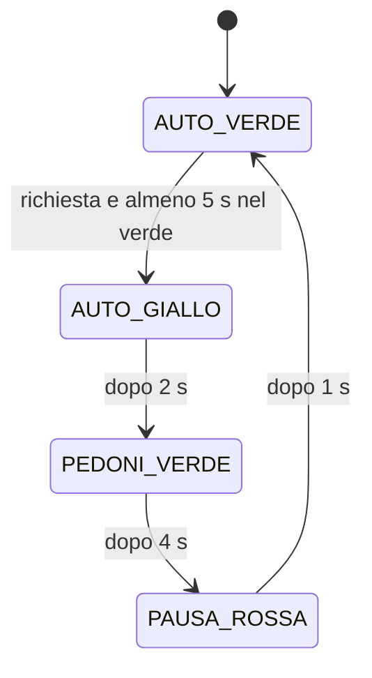

# Macchine a stati e semaforo

## Obiettivi e prerequisiti

Prerequisiti: guide 01–02 e debounce dell'esercitazione 03. Imparerai a separare stato, evento e condizione temporale, e a descrivere il programma con una tabella delle transizioni.

## Teoria e collegamento con l'architettura

### Quando sapere il tempo non basta

Un lampeggio dipende soltanto da una durata e dal livello precedente. Un semaforo deve ricordare anche **in quale fase si trova**: la stessa pressione può prenotare un attraversamento oppure essere ignorata. Una **macchina a stati finiti** descrive un insieme limitato di situazioni e le regole per passare dall'una all'altra.

Nell'[esempio completo](esempi/03_01-Semaforo-con-richiesta/README.md) la CPU ripete tre operazioni: aggiorna il filtro del pulsante, valuta la regola dello stato corrente e, quando serve, entra nel successivo. La RAM conserva stato, prenotazione e riferimenti temporali; i GPIO mostrano le uscite. Un riavvio cancella la prenotazione e riparte dal verde auto.

### Stati e uscite

È un modello didattico su breadboard, non un controllore per un impianto stradale. Il LED verde pedonale acceso indica la fase di attraversamento; spento indica che non si attraversa. Non è presente un LED rosso pedonale separato.

| Stato | Rosso auto, GPIO 18 | Giallo auto, GPIO 19 | Verde auto, GPIO 21 | Verde pedoni, GPIO 22 |
| --- | --- | --- | --- | --- |
| `AUTO_VERDE` | spento | spento | acceso | spento |
| `AUTO_GIALLO` | spento | acceso | spento | spento |
| `PEDONI_VERDE` | acceso | spento | spento | acceso |
| `PAUSA_ROSSA` | acceso | spento | spento | spento |

La funzione `enterState()` / `enter_state()` assegna le uscite e registra l'istante d'ingresso. Ripetere quell'assegnazione temporale a ogni giro impedirebbe la scadenza: si misurerebbe sempre da un istante appena aggiornato.

### Eventi e politica delle richieste

Una **pressione** è la transizione filtrata verso LOW dopo almeno 30 ms stabili. Il semplice livello LOW mantenuto non genera altre pressioni. All'avvio il filtro assume il livello presente: se il pulsante è già premuto occorrono rilascio stabile e nuova pressione.

L'esempio accetta richieste soltanto in `AUTO_VERDE`. Una variabile booleana conserva al massimo una prenotazione; pressioni aggiuntive nel verde non allungano il tempo e non creano una coda. Le pressioni negli altri stati sono ignorate. Il debounce continua comunque in ogni stato: un tasto mantenuto durante il ritorno al verde non diventa un nuovo evento.

| Stato corrente | Condizione | Stato successivo / azione |
| --- | --- | --- |
| `AUTO_VERDE` | Nuova pressione filtrata | Memorizza una prenotazione |
| `AUTO_VERDE` | Prenotazione presente **e** almeno 5000 ms dall'ingresso | Consuma la richiesta, entra in `AUTO_GIALLO` |
| `AUTO_GIALLO` | Almeno 2000 ms dall'ingresso | `PEDONI_VERDE` |
| `PEDONI_VERDE` | Almeno 4000 ms dall'ingresso | `PAUSA_ROSSA` |
| `PAUSA_ROSSA` | Almeno 1000 ms dall'ingresso | `AUTO_VERDE`, ricomincia il verde minimo |
| Qualunque stato | Nessuna condizione soddisfatta | Mantieni stato e uscite |

Il verde auto dura **almeno** 5 s, non sempre 5 s: senza richieste non termina. Una pressione accettata a 1 s aspetta il quinto secondo; una accettata a 8 s può avviare subito il giallo. Le durate decorrono dall'ingresso effettivo in ciascuno stato; il programma non salta fasi per recuperare un ritardo.

La variabile `greenReady` / `green_ready` diventa vera quando sono trascorsi i 5 s e conserva quel risultato. Da quel momento non occorre più confrontare il contatore con un riferimento sempre più lontano: il verde può restare attivo anche per molti giri del contatore. Entrando nuovamente nel verde, il flag riparte falso. Rimane necessario che il ciclo controlli frequentemente i tempi durante le fasi temporizzate.



## Esempi commentati

In C++ l'enumerazione dà un nome a ogni stato. Il seguente frammento mostra la regola del verde; le altre regole sono nello sketch completo:

```cpp
enum State { AUTO_VERDE, AUTO_GIALLO, PEDONI_VERDE, PAUSA_ROSSA };
// Dentro loop(), dopo l'aggiornamento del pulsante:
if (state == AUTO_VERDE) {
  if (!greenReady && now - enteredAt >= GREEN_MIN_MS) {
    greenReady = true;
  }
  if (requestPending && greenReady) {
    requestPending = false;
    enterState(AUTO_GIALLO, now);
  }
}
```

In MicroPython usiamo stringhe come nomi degli stati, per mantenere leggibile la prima implementazione:

```python
if state == AUTO_VERDE:
    if not green_ready and ticks_diff(now, entered_at) >= GREEN_MIN_MS:
        green_ready = True
    if request_pending and green_ready:
        request_pending = False
        enter_state(AUTO_GIALLO, now)
```

Il programma completo C++ usa `switch` / `case` con `break`: esegue il ramo dello stato corrente. MicroPython usa `if` / `elif`. Qui i rami sono alternativi perché esiste un solo stato attivo; nella guida 02 i due temporizzatori indipendenti richiedevano invece due `if`.

### Una traccia da seguire

Supponi che la richiesta diventi stabile a 1030 ms dall'avvio, senza ritardi apprezzabili:

| Tempo nominale dall'ingresso iniziale | Evento |
| --- | --- |
| 0 ms | `AUTO_VERDE` |
| 1030 ms | Richiesta accettata; resta `AUTO_VERDE` |
| 5000 ms | `AUTO_GIALLO`, richiesta consumata |
| 7000 ms | `PEDONI_VERDE` |
| 11000 ms | `PAUSA_ROSSA` |
| 12000 ms | `AUTO_VERDE`, nuovo riferimento temporale |

Un'altra pressione nel verde successivo avrà ancora il vincolo del nuovo intervallo minimo di 5 s. I tempi della tabella sono un modello nominale, non misure garantite del firmware.

## Buone pratiche e debug

- Definisci prima la politica delle pressioni fuori fase; non lasciare che derivi per caso dal codice.
- Stampa soltanto prenotazioni accettate e ingressi negli stati, non ogni giro.
- Mantieni gli stessi simboli e tempi nella tabella, nel codice e nel README.
- Se un tempo non scade, controlla che il riferimento cambi soltanto all'ingresso nello stato.
- Se una pressione mantenuta crea un nuovo attraversamento, controlla la distinzione tra livello ed evento e l'aggiornamento continuo del filtro.

## Autovalutazione

1. **Una pressione viene accettata a 1 s dall'ingresso in `AUTO_VERDE`. Quando può iniziare il giallo?**

   - A. Subito, a 1 s.
   - B. Al raggiungimento dei 5 s minimi del verde.
   - C. Sempre 5 s dopo la pressione, cioè a 6 s.
   - D. Solo dopo un riavvio.

2. **Che cosa succede a una pressione nuova durante `PEDONI_VERDE`?**

   - A. Azzera il tempo pedonale.
   - B. Avvia una coda illimitata.
   - C. Viene ignorata; il filtro continua ad aggiornarsi.
   - D. Accende il verde auto contemporaneamente.

3. **Quando viene aggiornato `enteredAt` / `entered_at`?**

   - A. A ogni lettura del pulsante.
   - B. A ogni giro del ciclo.
   - C. Solo all'avvio della console.
   - D. All'ingresso in uno stato.

## Esercizi pratici

1. **Consegna:** avvia senza premere e osserva per almeno 8 s.

   **Risultato atteso:** resta verde auto; il tempo minimo raggiunto da solo non basta per cambiare stato.

2. **Consegna:** premi durante il primo secondo e mantieni premuto fino al ritorno al verde.

   **Risultato atteso:** un solo attraversamento; dopo il ritorno non nasce un'altra richiesta finché non rilasci stabilmente e premi di nuovo.

3. **Consegna:** porta il verde pedoni a 6000 ms, lasciando invariati gli altri tempi.

   **Risultato atteso:** richiesta anticipata, giallo a circa 5 s, pedoni a 7 s, pausa rossa a 13 s e ritorno al verde a 14 s. Aggiorna la traccia e la tabella delle durate.

## Soluzioni dell'autovalutazione

1. **B.** Si misura il verde dall'ingresso nello stato, non dalla pressione.
2. **C.** È la politica scelta; il pulsante continua a essere campionato e filtrato.
3. **D.** È il riferimento da cui misurare la durata della fase.

## Navigazione del corso

- [📑 Indice generale](../README.md)
- [📂 Indice dell'esercitazione](README.md)
- [⬅️ Guida precedente](02-Temporizzazioni-indipendenti.md)
- La guida successiva appartiene all'esercitazione 05, ancora pianificata.
