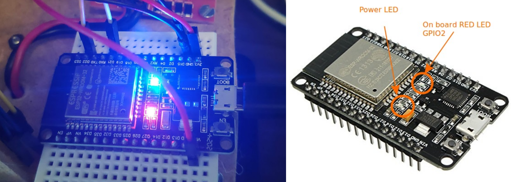

# LED · Blink, PWM e comandi con ESP32

La cartella raccoglie undici sketch per ESP32: dal lampeggio di un LED al controllo della luminosità, ai colori RGB e ai comandi seriali.

Ogni sketch è nella propria sottocartella Arduino, direttamente sotto `001-Led`, senza una cartella intermedia `esempi`. Apri un solo `.ino` alla volta insieme alla sua cartella.

## Introduzione teorica

### LED, corrente e PWM

Un LED emette luce quando è polarizzato direttamente. Per il collegamento a un GPIO usa **sempre una resistenza in serie**: GPIO → 220 Ω → anodo; catodo → GND. Verifica la polarità del componente reale, senza affidarti soltanto alla lunghezza dei terminali se sono stati tagliati.

La resistenza limita la corrente. Con 3,3 V ideali e un LED rosso con caduta di circa 2 V, la stima è `(3,3 − 2) / 220 ≈ 5,9 mA`; tensione d’uscita e caduta reale del LED possono essere diverse. Per tre LED o un RGB serve una resistenza **per ogni colore**, non una sola sul terminale comune.

`digitalWrite()` seleziona acceso o spento. Il PWM alterna rapidamente i due livelli e cambia la frazione di tempo in cui il LED è acceso. Gli esempi PWM usano `analogWrite()` con scala **0–255**, risoluzione **8 bit** e frequenza richiesta **5 kHz**. Questo è PWM, non una tensione continua prodotta dal DAC; luminosità percepita e valore numerico non sono necessariamente proporzionali.

La scheda di riferimento è **ESP32 classico WROOM-32**, per esempio DOIT ESP32 DEVKIT V1, con logica a **3,3 V**. Per i collegamenti usa i GPIO indicati nella tabella: non collegare LED ai GPIO 6–11 del modulo ESP32, normalmente impiegati dalla Flash. Non applicare 5 V ai GPIO.

## Materiali e piedinatura

Servono scheda ESP32 e cavo USB dati, breadboard, cavetti, LED e resistenze da **220 Ω**. L’esempio 02 richiede un pulsante; il 05 tre LED rosso/giallo/verde; il 06 un RGB **a catodo comune** e tre resistenze; il 07 sei LED e sei resistenze.

| Esempio | Pin ESP32 e collegamenti |
| --- | --- |
| Blink preesistente | GPIO 2: LED integrato, se presente, o LED esterno con 220 Ω |
| LED_01, 02, 03, 04, 08, 09, 10 | LED esterno sul GPIO 18 con 220 Ω, catodo a GND |
| LED_02 | Pulsante fra GPIO 23 e GND; `INPUT_PULLUP`, premuto = LOW |
| LED_05 | Rosso GPIO 18, giallo GPIO 19, verde GPIO 21; una resistenza per LED |
| LED_06 | R su GPIO 18, G su 19, B su 21; tre resistenze e catodo comune a GND |
| LED_07 | Sei LED nell’ordine GPIO 18, 19, 21, 22, 25, 26; una resistenza per LED |

Monta e modifica il circuito a scheda scollegata. I numeri sono GPIO, non posizioni fisiche dei pin. Il LED integrato sul GPIO 2 non è presente su tutte le DevKit: verifica il modello reale. Gli esempi LED_01–LED_10 usano il LED **esterno sul GPIO 18**, anche se la scheda ha un LED integrato.

## Sketch disponibili

| Sketch | Attività e risultato atteso |
| --- | --- |
| [01-LedBlink](01-LedBlink/01-LedBlink.ino) | Blink preesistente su GPIO 2: attesa iniziale di 500 ms, poi alternanza di 500 ms acceso e 500 ms spento |
| [LED_01 · Lampeggio semplice](LED_01_lampeggio_semplice/LED_01_lampeggio_semplice.ino) | GPIO 18 acceso per un secondo e spento per un secondo |
| [LED_02 · Pulsante](LED_02_controllo_pulsante/LED_02_controllo_pulsante.ino) | LED acceso mentre il pulsante è premuto; si spegne al rilascio |
| [LED_03 · Luminosità variabile](LED_03_luminosita_variabile/LED_03_luminosita_variabile.ino) | Rampa da 0 a 255 e ritorno, passi di 10 ms e pause agli estremi |
| [LED_04 · Respiro](LED_04_effetto_respiro/LED_04_effetto_respiro.ino) | Modulazione sinusoidale; il primo valore è circa metà scala, non zero |
| [LED_05 · Semaforo](LED_05_semaforo/LED_05_semaforo.ino) | Rosso 3 s, rosso+giallo 1 s, verde 3 s, giallo 1 s |
| [LED_06 · RGB](LED_06_led_rgb/LED_06_led_rgb.ino) | Rosso, verde, blu, giallo, ciano, magenta, bianco; poi transizione fra colori |
| [LED_07 · Knight Rider](LED_07_knight_rider/LED_07_knight_rider.ino) | Un LED alla volta si sposta lungo la fila e torna indietro, a passi di 100 ms |
| [LED_08 · Classe LED](LED_08_classe_led/LED_08_classe_led.ino) | Metodi per acceso, spento, inversione, lampeggio e luminosità; hardware inizializzato con `begin()` |
| [LED_09 · Non bloccante](LED_09_led_non_bloccante/LED_09_led_non_bloccante.ino) | Cambio di stato ogni secondo con `millis()`, mantenendo la lettura della seriale fra due cambi |
| [LED_10 · Comandi seriali](LED_10_led_seriale/LED_10_led_seriale.ino) | Comandi a righe per acceso/spento, cinque lampeggi e valore PWM |

Le fasi del semaforo sono una sequenza didattica, non un controllore stradale. Nel respiro la tabella calcolata parte dal seno di zero: il duty iniziale è 127; in 360 passi da 5 ms si attraversano massimo e minimo, con periodo nominale di 1,8 s più il tempo del codice.

## Arduino IDE

1. Installa **esp32 by Espressif Systems** e seleziona la scheda e la porta reali. Per la DOIT usa **DOIT ESP32 DEVKIT V1**; consulta la [guida Arduino IDE](../../01-Introduzione-ESP32/04-Arduino-IDE-e-DOIT-DevKit-V1.md) se necessario.
2. Per gli adattamenti PWM usa **Arduino-ESP32 3.x**. Non servono librerie esterne.
3. Apri il file nella sua sottocartella omonima, per esempio `LED_03_luminosita_variabile/LED_03_luminosita_variabile.ino`.
4. Collega i componenti secondo la tabella o il `diagram.json` dello stesso sketch.
5. Compila, carica e osserva il comportamento prima di modificare il codice.
6. Per gli esempi 09 e 10 apri il monitor seriale a **115200 baud**.

Non copiare tutti gli `.ino` in una sola cartella: avresti più definizioni di `setup()` e `loop()`. La classe dell’esempio 08 è inclusa nello sketch; il costruttore globale memorizza soltanto i dati e `setup()` chiama `led.begin()`.

Negli esempi 08 e 10 acceso/spento sono realizzati con valori PWM 255/0, mantenendo lo stesso tipo di uscita anche dopo una variazione di luminosità. Con LEDC sull’ESP32 non si deve supporre che alternare liberamente `digitalWrite()` e PWM sullo stesso pin mantenga la configurazione desiderata.

## Seriali: esempi 09 e 10

### LED_09 · Ricevere mentre il LED lampeggia

Invia un carattere, per esempio `x`: il programma risponde `Ho ricevuto: x` mentre il lampeggio continua. Il timer viene inizializzato in `setup()`; il primo cambio del LED avviene dopo circa un secondo. Se scegli di inviare LF o CRLF, anche quei byte vengono letti e riportati.

La decisione temporale usa `millis()` e sottrazione unsigned. Il ciclo mantiene una breve pausa cooperativa di 1 ms: non attende un secondo per poter leggere la seriale. Se il ciclo arriva tardi, cambia stato una sola volta dal tempo osservato.

### LED_10 · Un comando per riga

Imposta il terminatore del monitor a **LF** oppure **CRLF**, invia una richiesta e attendi la risposta.

| Comando | Effetto |
| --- | --- |
| `a` | Duty 255, LED acceso |
| `s` | Duty 0, LED spento |
| `b128` | Duty 128 |
| `b0` / `b255` | Spento / massimo duty |
| `l` | Cinque lampeggi da 200 ms acceso e 200 ms spento, poi ripristino del valore PWM precedente |

Il comando `b` richiede da una a tre cifre; il risultato è limitato a 0–255, quindi `b999` viene limitato a 255. Una riga vuota è ignorata; grammatica errata produce `ERR COMMAND`. Il buffer ammette fino a cinque byte prima di LF, compreso l’eventuale CR finale; righe più lunghe vengono scartate fino a LF e producono `ERR LENGTH`. Una riga parziale non viene eseguita prima di LF e non ha un timeout.

I comandi frammentati fra più letture vengono ricomposti. Il ricevitore elabora al massimo 32 byte per giro. **Il comando `l` resta bloccante per circa due secondi**: durante la sequenza non vengono elaborati altri comandi. Non inviare un flusso continuo; i buffer della UART hanno capacità finita. Al ritorno, il valore precedente viene ripristinato anche se era intermedio, per esempio 128.

## Wokwi

Ogni sottocartella include un **`diagram.json`** con il circuito dello sketch, comprese le resistenze da 220 Ω. Non servono `libraries.txt`.

1. Apri un modello [ESP32 Arduino Wokwi](https://docs.wokwi.com/guides/esp32).
2. Copia lo sketch scelto nel file principale del modello, normalmente `sketch.ino`.
3. Sostituisci `diagram.json` con quello della stessa sottocartella e avvia.
4. Nel 02 premi il pulsante; nel 06 verifica che il componente sia impostato a **catodo comune**; nel 10 configura il terminatore LF o CRLF.
5. Ripeti sulla scheda reale, annotando modello, core, collegamenti e comportamento osservato.

Il diagramma del Blink preesistente mostra anche un LED esterno sul GPIO 2: può essere usato se manca quello integrato. La simulazione non sostituisce la verifica della corrente, della luminosità o della polarità del componente reale.

## Esercizi

1. **Tempi del Blink:** modifica separatamente durata di acceso e spento e calcola periodo e duty del lampeggio lento.
2. **Pulsante a commutazione:** trasforma LED_02 in un comando che cambia stato una volta per nuovo tocco, includendo un filtro dei rimbalzi.
3. **Rampa con `millis()`:** riscrivi LED_03 mantenendo la ricezione seriale attiva durante l’intera dissolvenza.
4. **Semaforo a stati:** elimina le lunghe attese di LED_05 e aggiungi una richiesta pedonale memorizzata.
5. **Colori RGB:** confronta colori a duty intero e a metà scala; spiega perché la percezione e i tre canali non sono calibrati solo dai numeri.
6. **Due animazioni indipendenti:** usa due oggetti LED con intervalli diversi, evitando che il metodo di lampeggio di uno blocchi l’altro.
7. **Lampeggio seriale interrompibile:** riscrivi `l` con una macchina a stati e consenti a `s` di interromperlo; specifica che cosa succede al valore PWM salvato.

## Stato dei materiali e delle verifiche

Sono disponibili undici sketch e undici diagrammi. Controlli locali del **24 ottobre 2026**: gli undici sketch sono stati compilati con g++ e API sostituite, senza avvisi; sono state superate **33 esecuzioni**. I casi comprendono sequenze digitali e PWM, pulsante, respiro, colori RGB, andata/ritorno dei sei LED, metodi della classe, timer e ritorno a zero, ricezione durante il lampeggio, comandi frammentati, LF/CRLF, righe non valide o troppo lunghe e ripristino della luminosità dopo il lampeggio seriale.

Sono stati verificati gli undici diagrammi, pin e resistenze, collegamenti locali, corrispondenza fra nomi dei file e cartelle. Il modello temporale usa la larghezza nativa di `unsigned long` del computer e non emula la CPU o i tempi reali delle periferiche.

**Compilazione con core ESP32 reale, esecuzione Wokwi e collaudo hardware sono da eseguire.** I controlli sul computer con API sostituite non provano corrente, segnale PWM reale, resa luminosa o buffer UART della scheda.

## Riferimenti e navigazione

- [Licenza GNU AGPLv3](../../LICENSE).
- [Espressif: GPIO e pin riservati](https://docs.espressif.com/projects/esp-idf/en/stable/esp32/api-reference/peripherals/gpio.html).
- [Espressif: PWM e analogWrite](https://docs.espressif.com/projects/arduino-esp32/en/latest/api/ledc.html).
- [Approfondimento su uscite digitali e LED](../../02-Uscite-digitali-e-LED/README.md).
- [Indice ESP32-DEVKIT](../README.md).
- [Indice generale del corso](../../README.md).
