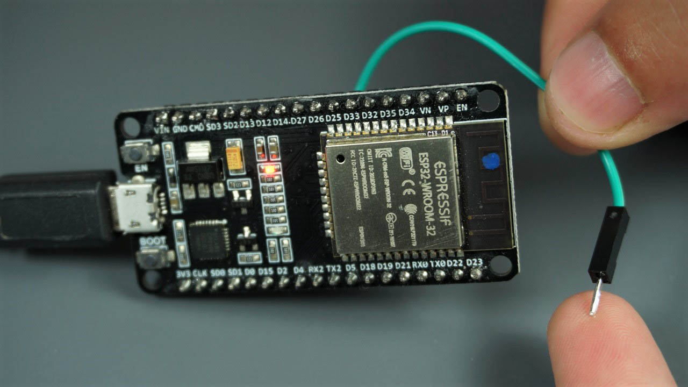

# TouchPress · Sensori capacitivi con ESP32

## Introduzione teorica

Un comando touch rileva il contatto di un dito senza richiedere la chiusura meccanica di un pulsante. Un piccolo elettrodo metallico, collegato a un ingresso dedicato, costituisce una capacità elettrica rispetto all’ambiente circostante. Avvicinando o appoggiando il dito, questa capacità cambia e il microcontrollore può riconoscere il tocco.

Il sensore **non misura la forza della pressione**: un contatto più forte non corrisponde necessariamente a un valore proporzionale. La lettura dipende anche da superficie dell’elettrodo, lunghezza del filo, umidità, alimentazione e posizione della mano. Un filo con un’estremità metallica accessibile è sufficiente per una prima prova; una piazzola di rame o alluminio permette di costruire un tasto più comodo.

L’ESP32 classico integra una periferica che ricava un conteggio dai cicli di carica e scarica dell’elettrodo. Il programma acquisisce il dato con `touchRead(pin)` e lo confronta con una soglia per ricavare uno stato logico: **toccato** oppure **rilasciato**. La lettura è un conteggio, non una tensione, una capacità espressa in farad o una misura di pressione. [Documentazione Espressif sul sensore touch](https://docs.espressif.com/projects/esp-idf/en/v5.4.3/esp32/api-reference/peripherals/touch_pad.html).

Nell’**ESP32 classico con modulo ESP32-WROOM-32**, il valore normalmente **diminuisce durante il tocco**. Questa regola e la piedinatura non vanno trasferite automaticamente a ESP32-S2/S3, che hanno un comportamento diverso, o a varianti prive della periferica. Verifica sempre il modello della scheda e la relativa [API Arduino touch](https://docs.espressif.com/projects/arduino-esp32/en/latest/api/touch.html).



*L’immagine fornita mostra il principio della prova con un filo e un dito. Per riprodurre lo sketch segui i collegamenti riportati qui sotto: la fotografia non sostituisce il pinout della tua scheda.*

### Dalla lettura alla decisione

Supponiamo, solo come esempio, di osservare valori fra 55 e 70 senza tocco e fra 10 e 18 durante il tocco. Una soglia pari a 20 può separare i due intervalli. Su un altro montaggio gli intervalli potrebbero essere diversi: **20 è il valore iniziale dello sketch, non una costante universale**.

Una soglia troppo bassa può perdere tocchi; una troppo alta può interpretare come tocchi anche le normali oscillazioni. Quando i due intervalli si sovrappongono, cambiare un solo numero può non bastare: servono un montaggio più stabile, filtraggio o una decisione che tenga conto del tempo.

## Obiettivo dell’esempio

Lo sketch [01-TouchPress.ino](01-TouchPress.ino) propone tre prove: visualizzare le letture sul monitor seriale, osservarle nel plotter e usare due tasti capacitivi per memorizzare lo stato di un LED. La prova attiva è `test3()`.

Al termine saprai identificare gli ingressi touch, calibrare una soglia e distinguere il livello “dito presente” dall’evento “nuovo tocco”. Gli esercizi finali estendono il progetto fino a un piccolo pianoforte capacitivo.

## Materiali e collegamenti

- ESP32 classico con modulo WROOM-32, per esempio una DOIT ESP32 DEVKIT V1, e cavo USB dati.
- Due cavetti, eventualmente collegati a due piazzole metalliche separate e fissate su un supporto isolante.
- LED integrato sul GPIO 2, se presente sulla scheda.
- In alternativa, un LED esterno e una resistenza da **220 Ω**: GPIO 2 → resistenza → anodo; catodo → GND.

| Funzione nello sketch | Canale touch | GPIO |
| --- | --- | --- |
| Comando di accensione | T4 | 13 |
| Comando di spegnimento | T5 | 12 |
| Uscita LED | — | 2 |

Collega una piazzola al GPIO 13 e l’altra al GPIO 12. Non collegare le piazzole fra loro, a 3V3 o a GND: sono elettrodi di misura, non contatti da cortocircuitare come un pulsante. Non aggiungere `INPUT_PULLUP` agli ingressi touch. Scollega l’alimentazione prima di modificare i collegamenti e non applicare segnali a 5 V ai GPIO.

**GPIO 12 influisce sull’avvio dell’ESP32 classico:** non aggiungere un pull-up o un circuito che lo forzi alto durante il reset. Se un dispositivo esterno collegato a questo pin impedisce l’avvio, scollegalo e verifica il cablaggio. [Espressif: pin di configurazione all’avvio](https://docs.espressif.com/projects/esptool/en/latest/esp32/advanced-topics/boot-mode-selection.html#other-pins).

Il LED sul GPIO 2 dipende dalla scheda: alcune DevKit non lo montano. Lo sketch assume un LED **attivo alto**, acceso con `HIGH`. Verifica piedinatura e polarità del modello reale.

### Altri pin touch dell’ESP32 classico

| Canale | GPIO | Canale | GPIO |
| --- | --- | --- | --- |
| T0 | 4 | T5 | 12 |
| T1 | 0 | T6 | 14 |
| T2 | 2 | T7 | 27 |
| T3 | 15 | T8 | 33 |
| T4 | 13 | T9 | 32 |

La corrispondenza è definita nei [pin Arduino dell’ESP32 classico](https://github.com/espressif/arduino-esp32/blob/master/variants/esp32/pins_arduino.h). Non utilizzare contemporaneamente GPIO 2 come uscita LED e ingresso touch T2. Per le estensioni scegli pin liberi, considerando anche i vincoli di avvio dei GPIO 0, 2, 12 e 15.

## Esecuzione in Arduino IDE

1. Installa Arduino IDE e il pacchetto **esp32 by Espressif Systems**. Se necessario consulta la [guida Arduino IDE del corso](../../01-Introduzione-ESP32/04-Arduino-IDE-e-DOIT-DevKit-V1.md).
2. Per Arduino IDE copia `01-TouchPress.ino` in una cartella chiamata `01-TouchPress`, quindi aprilo e seleziona scheda e porta corrette. Il nome della cartella dello sketch deve coincidere con quello del file principale senza estensione; la cartella del repository `002-TouchPress` contiene anche questa guida e l’immagine. Per la DOIT scegli **DOIT ESP32 DEVKIT V1**.
3. Compila e carica. Non sono richieste librerie esterne.
4. Apri il monitor seriale a **115200 baud**. Dopo circa un secondo viene stampato `ESP32 Touch Test`.
5. Seleziona la prova da eseguire modificando la sola chiamata in `loop()` e caricando nuovamente lo sketch.

Esegui queste prove su hardware reale: la rilevazione dipende dall’elettrodo e dall’ambiente. Un pulsante simulato non riproduce automaticamente il comportamento capacitivo del dito.

## Le tre prove dello sketch

### `test1()` · Monitor seriale

Legge T4 e T5 e stampa una riga ogni 100 ms tramite la macro `debug`:

```text
test1: TOUCH4_PIN=62, TOUCH5_PIN=59
```

I numeri sono soltanto un esempio. Per attivare questa prova usa:

```cpp
void loop() {
  test1();
}
```

Tocca prima una piazzola e poi l’altra, osservando quale lettura cambia. La macro aggiunge il nome della funzione che l’ha chiamata, grazie a `__func__`.

### `test2()` · Plotter seriale

Stampa soltanto la lettura di T4, adatta a essere rappresentata come una curva. Sostituisci `test1()` con `test2()` in `loop()` e apri il plotter seriale a 115200 baud.

Nel codice originale non è presente una pausa esplicita in questa funzione. Per rendere il grafico più leggibile puoi aggiungere `delay(20)` alla fine della prova: è una modifica proposta, non già presente nel file.

### `test3()` · Due comandi e memoria del LED

È la prova richiamata attualmente da `loop()`. Legge entrambi i canali, ma invia al plotter **soltanto T4**.

```cpp
if (t4 < TOUCH_THRESHOLD && t4) {
  digitalWrite(LED_PIN, HIGH);
}
if (t5 < TOUCH_THRESHOLD && t5) {
  digitalWrite(LED_PIN, LOW);
}
```

Con `TOUCH_THRESHOLD` pari a 20, ogni condizione riconosce i valori da **1 a 19**. Il secondo operando esclude lo zero; ciò non costituisce una diagnostica completa del sensore. Anche una lettura uguale a 20 è esclusa, perché il confronto è strettamente `<`.

| Situazione, secondo le condizioni del programma | Risultato |
| --- | --- |
| T4 riconosciuto, T5 no | LED acceso |
| T5 riconosciuto, T4 no | LED spento |
| Nessuno dei due riconosciuto | Stato precedente conservato |
| Entrambi riconosciuti nello stesso giro | LED spento: il secondo `if` viene eseguito per ultimo |

Il LED **non si spegne rilasciando T4**: resta acceso fino al comando su T5. Questo è uno stato memorizzato, diverso da un LED che segue direttamente il dito. I canali sono letti in sequenza, quindi non sono due misure simultanee.

## Calibrazione e limiti del codice originale

### Conservare l’intera lettura

Nelle tre prove il risultato di `touchRead()` è assegnato a `byte`, che contiene soltanto valori da 0 a 255. L’API dell’ESP32 classico restituisce invece un dato a 16 bit: valori più grandi possono essere troncati e produrre confronti ingannevoli.

Prima della calibrazione, una modifica consigliata è usare, in tutte le prove:

```cpp
auto t4 = touchRead(T4);
auto t5 = touchRead(T5);
```

In `test2()` serve soltanto `t4`. `auto` conserva il tipo restituito dall’API. Questa correzione è proposta qui come attività: **lo sketch originale non è stato modificato**.

### Misurare prima di scegliere la soglia

1. Attiva `test1()` e lascia entrambe le piazzole libere per alcuni secondi.
2. Registra minimo e massimo per ciascun canale senza tocco.
3. Tocca e rilascia ciascuna piazzola almeno dieci volte e registra gli intervalli durante il contatto.
4. Separa gli intervalli con una soglia per canale: non assumere che due elettrodi richiedano lo stesso valore.
5. Ripeti dopo aver cambiato fili o superficie delle piazzole.

| Elettrodo | Senza tocco: min–max | Con tocco: min–max | Soglia scelta | Tocchi riconosciuti su 10 |
| --- | --- | --- | --- | --- |
| T4 / GPIO 13 | Da misurare | Da misurare | Da scegliere | Da verificare |
| T5 / GPIO 12 | Da misurare | Da misurare | Da scegliere | Da verificare |

Per rendere esplicito lo stato iniziale del LED puoi aggiungere `digitalWrite(LED_PIN, LOW)` dopo `pinMode()` in `setup()`. Per limitare il traffico seriale puoi campionare o stampare a intervalli: `test3()` non contiene una pausa esplicita e ogni lettura touch richiede comunque tempo.

## Esercizi progressivi

### 1. Confrontare i due elettrodi

**Consegna:** modifica `test2()` per mostrare sul plotter entrambe le letture, con due etichette numeriche, e completa la tabella di calibrazione.

**Risultato atteso:** due curve distinguibili; toccando T4 cambia soprattutto la sua curva. Se cambia anche T5, verifica distanza fra elettrodi, contatti accidentali e disposizione dei fili.

### 2. Soglie separate e priorità esplicita

**Consegna:** sostituisci `TOUCH_THRESHOLD` con due soglie calibrate. Mantieni due comandi, ma scegli e documenta la priorità quando entrambi sono riconosciuti. Confronta due `if` indipendenti con una struttura `if`/`else if`.

**Risultato atteso:** accensione e spegnimento affidabili con entrambi gli elettrodi; il tocco contemporaneo produce il comportamento dichiarato. Riporta anche come tratti una lettura zero.

### 3. Un solo tasto, un solo cambiamento per tocco

**Consegna:** usa T4 per invertire lo stato del LED a ogni nuovo tocco. Conserva lo stato precedente del sensore e cambia il LED soltanto nella transizione da rilasciato a toccato.

**Risultato atteso:** tenendo il dito sulla piazzola per due secondi il LED cambia una sola volta. Una semplice inversione a ogni giro di `loop()` non soddisfa la consegna.

**Estensione:** introduci isteresi: sul classico ESP32 riconosci il tocco sotto una soglia bassa e il rilascio sopra una soglia più alta, mantenendo lo stato nella banda intermedia. Ricava entrambe le soglie dalle tue misure. Puoi richiedere anche più campioni consecutivi, valutando il ritardo aggiunto.

### 4. Pianoforte capacitivo a quattro tasti

**Consegna:** costruisci quattro piazzole separate e associa a ciascuna una nota. Aggiungi un piccolo **piezo passivo ad alta impedenza**, collegato a GPIO 18 attraverso una resistenza da **1 kΩ**, con l’altro terminale a GND. Il buzzer attivo e l’altoparlante da 8 Ω non sono sostituti diretti di questo componente.

| Tasto | Canale | GPIO | Nota | Frequenza richiesta |
| --- | --- | --- | --- | --- |
| 1 | T4 | 13 | DO4 | 262 Hz |
| 2 | T6 | 14 | RE4 | 294 Hz |
| 3 | T7 | 27 | MI4 | 330 Hz |
| 4 | T8 | 33 | FA4 | 349 Hz |

Per questo esercizio T5/GPIO 12 non serve. Calibra separatamente i quattro ingressi; non usare i pin scelti anche come uscite digitali.

Il pianoforte è **monofonico**: suona una sola nota alla volta. Se più tasti risultano toccati, assegna priorità al primo nella tabella; quando viene rilasciato, passa al successivo ancora toccato. Se nessuno è toccato, interrompi il tono.

Per il suono puoi usare LEDC con **Arduino-ESP32 3.x**:

```cpp
// In setup(), controllando il risultato della configurazione:
bool buzzerReady = ledcAttach(18, 440, 8);

// Quando serve una nota, se buzzerReady è true:
ledcWriteTone(18, 262);

// Quando nessun tasto è attivo:
ledcWriteTone(18, 0);
```

Sono frammenti da integrare, non uno sketch completo. Nel programma conserva `buzzerReady` in una variabile accessibile a `loop()`, gestisci un eventuale errore e aggiorna il tono soltanto quando cambia la nota selezionata. L’API 3.x usa il **pin**: non mescolarla con gli esempi 2.x basati su `ledcSetup()` e `ledcAttachPin()`. [API LEDC](https://docs.espressif.com/projects/arduino-esp32/en/latest/api/ledc.html), [guida di migrazione](https://docs.espressif.com/projects/arduino-esp32/en/latest/migration_guides/2.x_to_3.0.html#ledc).

**Schema dell’algoritmo:**

```text
leggi i quattro ingressi e aggiorna i relativi stati touch
scegli il primo tasto toccato, oppure nessuno
se la scelta è cambiata:
    avvia la frequenza associata, oppure ferma il tono
ripeti senza aspettare la fine di una nota
```

**Prove richieste:** ogni tasto singolo, pressione mantenuta, rilascio, passaggio diretto fra due tasti e due tocchi contemporanei. Il suono deve durare finché almeno un tasto selezionabile rimane toccato; il rilascio di tutti i tasti deve produrre silenzio.

**Estensioni:** aggiungi SOL4 a 392 Hz su T9/GPIO 32 e LA4 a 440 Hz su T0/GPIO 4; oppure registra una breve sequenza di note e durate per riascoltarla. Per la registrazione fissa un numero massimo di eventi e gestisci il buffer pieno.

Per approfondire la generazione sonora consulta l’[esercitazione su output analogici, DAC e buzzer](../../06-Output-analogici-e-DAC/README.md).

## Verifica finale

Prima di considerare completata l’attività, spiega:

1. Perché il sensore rileva il contatto ma non misura direttamente la forza del dito.
2. Perché la soglia 20 può funzionare su un montaggio e fallire su un altro.
3. Perché il LED rimane acceso dopo il rilascio di T4 nello sketch originale.
4. Perché il tipo `byte` può alterare il dato e quale tipo useresti al suo posto.
5. Come il pianoforte sceglie una nota quando due elettrodi vengono toccati insieme.

Consegna codice, foto del cablaggio, tabella di calibrazione e risultati osservati. Compilazione con la tua versione del core e prove fisiche vanno registrate: le descrizioni di questa guida indicano il comportamento del codice e le prove da effettuare, non un collaudo già svolto sulla tua scheda.

## Navigazione

- [Indice degli esempi ESP32-DEVKIT](../README.md)
- [Indice generale del corso](../../README.md)
- [Sketch TouchPress](01-TouchPress.ino)
