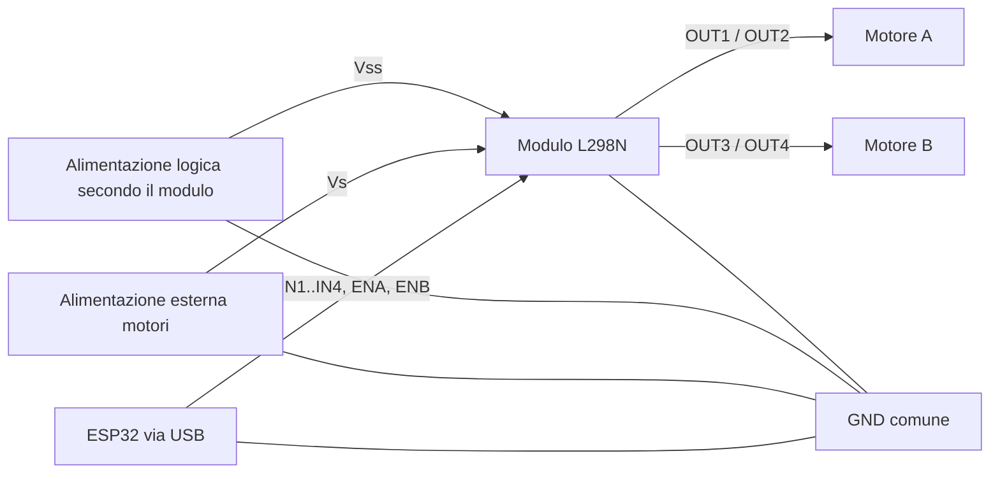

# Motors · Due motori DC con ESP32 e L298N

## Introduzione teorica

Un motore DC a spazzole trasforma energia elettrica in rotazione. Invertendo la polarità applicata ai suoi terminali cambia il verso; modificando l’eccitazione cambia il comportamento sotto carico. Un GPIO fornisce un **segnale di comando**, non la corrente necessaria al motore.

Il **L298N** contiene due ponti H: ciascuno può applicare al proprio motore una polarità o quella opposta. Il ponte A usa IN1, IN2 ed ENA; il ponte B usa IN3, IN4 ed ENB. L’alimentazione di potenza arriva da una sorgente esterna. [ST: descrizione del L298](https://www.st.com/en/motor-drivers/l298.html).

### Direzione, arresto e frenatura

La tabella seguente vale per un ponte; `INa`/`INb` indicano IN1/IN2 oppure IN3/IN4.

| EN | INa | INb | Comando |
| --- | --- | --- | --- |
| Basso | Qualsiasi | Qualsiasi | Uscite disabilitate, arresto per inerzia |
| Alto | Alto | Basso | Rotazione positiva nella convenzione del cablaggio |
| Alto | Basso | Alto | Rotazione negativa |
| Alto | Uguali | Uguali | Frenatura elettrica |

Con `stop()` il ponte viene disabilitato: il rotore può continuare a girare. Con `brake()` il ponte resta attivo e ostacola elettricamente la rotazione. La frenatura può produrre correnti elevate e non è una funzione di arresto di emergenza. Le prove iniziali usano l’arresto per inerzia. [ST: tabella di comando e applicazioni, pagine 8–9](https://www.st.com/resource/en/datasheet/l298.pdf).

La scritta “avanti” è una convenzione: dipende dai collegamenti del motore e dal montaggio delle ruote. Su un robot due motori montati specularmente possono richiedere un’inversione di cablaggio per ottenere l’avanzamento con due comandi positivi. Verifica prima ogni ruota sollevata.

### PWM, coppia e velocità

Gli esempi inviano il PWM agli **enable**, mantenendo gli ingressi di direzione stabili. La periferica LEDC dell’ESP32 genera gli impulsi a **5 kHz**, con risoluzione **12 bit**. Il valore scritto all’API varia da 0 a 4095:

```text
duty = percentuale × 4095 / 100   (divisione intera)
```

| Comando in modulo | Valore duty scritto |
| --- | --- |
| 0% | 0 |
| 50% | 2047 |
| 100% | 4095 |

La percentuale è un **comando PWM**, non una misura di giri/minuto. Il motore può non partire con un duty basso, e velocità e coppia dipendono anche da carico, alimentazione e attriti. Un comando troppo basso può lasciare il motore fermo ma alimentato: non insistere se non gira. Non è presente un encoder né una regolazione ad anello chiuso.

Il L298 introduce una caduta di tensione e dissipa calore. Dimensiona alimentazione, modulo e raffreddamento considerando anche la corrente di avviamento e di stallo; la corrente dichiarata per il circuito integrato non garantisce quella continua di qualunque schedina commerciale.

## Materiali e alimentazione

- ESP32 classico WROOM-32, per esempio DOIT ESP32 DEVKIT V1, con cavo USB dati.
- Modulo L298N completo, con diodi di ricircolo e dissipazione adeguata.
- Uno o due piccoli motori DC a spazzole compatibili con alimentazione e driver.
- Alimentazione esterna per i motori, scelta in base ai componenti; collegamenti adatti alla corrente.
- Pulsante normalmente aperto da usare come abilitazione mantenuta.
- Due resistenze da **10 kΩ**, una da ENA a GND e una da ENB a GND, per tenere disabilitati i ponti durante il reset.
- Per la regolazione: potenziometro lineare da **10 kΩ**.

Non alimentare i motori dai GPIO, dal pin 3V3 o tramite l’ESP32. Il circuito richiede **massa comune** fra ESP32, driver e sorgente dei motori; separa il percorso di potenza dai cavetti dei segnali.



Il modulo richiede anche l’alimentazione della logica: verifica il suo manuale. Il L298 impiega normalmente una logica alimentata a 5 V e accetta segnali TTL dell’ESP32; questo **non autorizza a portare 5 V su un GPIO**. Sul chip nudo servono anche i componenti esterni indicati dal datasheet: questa guida presuppone un modulo completo.

**Distingui i jumper:**

- Rimuovi i ponticelli **ENA/ENB** che forzano gli enable al livello alto, prima di collegare i GPIO PWM. Altrimenti non controlli correttamente l’abilitazione e puoi mettere in conflitto le alimentazioni.
- L’eventuale jumper **5V-EN** del regolatore è un’altra cosa: la configurazione e il ruolo del morsetto 5V dipendono dal modulo. Segui il suo schema; non unire alla cieca l’uscita di un regolatore a un’altra sorgente.

Collega e scollega a circuito non alimentato. Nelle prime prove tieni ruote sollevate e parti mobili libere. Il rilascio del pulsante viene letto dal software e comanda lo stop; non sostituisce un’interruzione fisica dell’alimentazione di potenza.

## Piedinatura del progetto

La libreria mantiene i GPIO della versione originale, definiti in `MyMotors.h`.

| Modulo o componente | ESP32 / collegamento |
| --- | --- |
| IN1, ponte A | GPIO 5 |
| IN2, ponte A | GPIO 18 |
| ENA, ponte A | GPIO 19, canale LEDC 0; pull-down 10 kΩ a GND |
| IN3, ponte B | GPIO 17 |
| IN4, ponte B | GPIO 16 |
| ENB, ponte B | GPIO 4, canale LEDC 1; pull-down 10 kΩ a GND |
| GND driver e negativo alimentazione motori | GND comune con ESP32 |
| Vs / alimentazione motori del modulo, spesso etichettata +12V | Positivo della sorgente esterna; tensione scelta per motori e modulo, non necessariamente 12 V |
| Alimentazione logica del modulo | Secondo lo schema del modulo e la posizione del jumper del regolatore |
| OUT1 e OUT2 | Due terminali del motore A |
| OUT3 e OUT4 | Due terminali del motore B |
| Pulsante di abilitazione | GPIO 23 e GND; `INPUT_PULLUP` |
| Potenziometro, esempio 03 | Estremi a 3V3/GND; cursore a GPIO 34 |

GPIO 5 è un pin di configurazione all’avvio: non aggiungere circuiti che ne impongano un livello incompatibile durante il reset. GPIO 16/17 possono essere riservati su moduli con PSRAM: la piedinatura è riferita al WROOM-32. Il pulsante premuto legge **LOW**. I pull-down degli enable sono esterni, distinti dal pull-up del pulsante.

Nell’esempio 02 viene comandato solo il motore A; il ponte B viene inizializzato disabilitato. È possibile provare inizialmente senza collegare il secondo motore.

## Installazione e organizzazione degli sketch

Installa **esp32 by Espressif Systems** e seleziona la scheda e la porta. Gli esempi aggiornati richiedono **Arduino-ESP32 3.x**, con `ledcAttachChannel()` e `ledcWrite()` riferita al pin. Non mescolare queste firme con le vecchie `ledcSetup()`/`ledcAttachPin()` dell’API 2.x. [Guida Espressif alla migrazione](https://docs.espressif.com/projects/arduino-esp32/en/latest/migration_guides/2.x_to_3.0.html#ledc).

Non servono librerie esterne: ogni cartella contiene una copia autonoma dei file locali `MyMotors`, `L298N` e `L298N_2M`. Apri il `.ino` nella **sua** cartella e mantieni insieme tutti i `.h` e `.cpp`. Non mettere più sketch nella stessa cartella, perché ciascuno definisce `setup()` e `loop()`.

| Cartella e sketch | Attività |
| --- | --- |
| [01-Motors/01-Motors.ino](01-Motors/01-Motors.ino) | Due motori: positivo, stop, negativo, stop |
| [02-Un-motore/02-Un-motore.ino](02-Un-motore/02-Un-motore.ino) | Un solo ponte al 50%, con abilitazione mantenuta |
| [03-Potenziometro-e-PWM/03-Potenziometro-e-PWM.ino](03-Potenziometro-e-PWM/03-Potenziometro-e-PWM.ino) | Comando del motore A dal potenziometro |
| [04-Movimenti-robot/04-Movimenti-robot.ino](04-Movimenti-robot/04-Movimenti-robot.ino) | Comandi separati per ruote sinistra e destra |

Tutte le cartelle sono direttamente in `004-Motors`; non c’è una cartella intermedia `esempi`. Per modificare la libreria in più progetti aggiorna coerentemente le copie: l’autonomia delle cartelle comporta che non esiste un’unica copia condivisa durante la compilazione.

## Comportamento degli esempi

### 01 · Due motori con pause fra i versi

All’avvio entrambi i ponti sono disabilitati; la seriale a **115200 baud** mostra `PRONTO: tieni premuto GPIO23`. Finché non premi il pulsante non viene richiesto movimento.

Mantenendolo premuto, si ripete la sequenza:

| Fase | Comando di entrambi | Durata nominale |
| --- | --- | --- |
| 0 | +60% | 2000 ms |
| 1 | Stop per inerzia | 500 ms |
| 2 | −60% | 2000 ms |
| 3 | Stop per inerzia | 500 ms |

Rilasciando il pulsante si comanda lo stop e la sequenza viene interrotta. Alla nuova pressione riparte dalla fase 0. Le pause sono un punto di partenza didattico: adattale al tempo di arresto effettivo prima di invertire un carico reale. Il programma non misura se il rotore è fermo.

La vecchia demo eseguiva `test('2')` in `setup()`. Questo sketch usa invece una macchina a stati in `loop()` e può controllare il pulsante fra due passaggi.

### 02 · Un solo motore

Premendo e mantenendo premuto il pulsante, il motore A riceve **+50%** e il ponte B rimane disabilitato. La seriale mostra `M1=50 M2=0`. Al rilascio compare `STOP` e il ponte A viene disabilitato.

Questa è la prima prova consigliata dopo il controllo dei segnali senza motori. Se il motore non parte, verifica cablaggio, sorgente e carico; non presumere che un duty del 50% sia sufficiente per qualunque motore.

### 03 · Regolare il comando con il potenziometro

Con pulsante premuto il programma legge GPIO 34 ogni **100 ms nominali**. L’ADC è configurato a 12 bit e attenuazione a 11 dB. L’intervallo iniziale fino al codice 100 forza lo stop; oltre questo valore si applica:

```text
percentuale = (raw − 100) × 100 / 3995    (divisione intera)
```

Per troncamento il risultato rimane zero fino a raw=139 e diventa 1 a raw=140. A raw=2048 vale 48, a raw=4095 vale 100. Non ci sono soglie nascoste che trasformano il comando zero in un duty minimo.

La seriale stampa `ADC=n CMD=p` quando cambia la percentuale e l’aggiornamento PWM viene limitato ai cambiamenti del comando. Il motore B rimane spento. Rilasciando il pulsante il programma comanda lo stop senza attendere la prossima acquisizione; una nuova pressione esegue subito una lettura. Per la prima prova porta la manopola a zero prima di abilitare.

### 04 · Movimenti di un robot a due ruote

Il motore A rappresenta la ruota sinistra, il B la destra. Con pulsante mantenuto premuto vengono richiesti:

| Fase | Sinistra | Destra | Durata nominale |
| --- | --- | --- | --- |
| 0 | +60% | +60% | 1500 ms |
| 1 | 0 | 0 | 500 ms |
| 2 | +30% | +60% | 1000 ms |
| 3 | 0 | 0 | 500 ms |
| 4 | +60% | +30% | 1000 ms |
| 5 | 0 | 0 | 500 ms |
| 6 | +50% | −50% | 800 ms |
| 7 | 0 | 0 | 500 ms |

I comandi descrivono avanzamento, curve e rotazione sul posto **soltanto dopo aver verificato la convenzione delle ruote**. Due percentuali uguali non garantiscono una traiettoria rettilinea e 800 ms non corrispondono a un angolo noto. Non ci sono encoder, sensori di posizione o sincronizzazione meccanica.

Il ciclo nominale dura 6300 ms. Se il programma arriva tardi, avanza di una fase dal tempo osservato; non esegue raffiche per recuperare movimenti arretrati. Il rilascio interrompe la sequenza e la pressione successiva riparte dalla fase 0.

## API della libreria locale

`MyMotors` mantiene la configurazione del progetto; `L298N_2M` combina i due ponti e `L298N` controlla un ponte. I costruttori memorizzano i parametri senza comandare GPIO o usare la seriale prima di `setup()`.

| Metodo su `MyMotors` / `L298N_2M` | Significato |
| --- | --- |
| `begin()` | Configura i due PWM, inizialmente a zero; restituisce `bool` |
| `isReady()` | Indica che entrambi i canali risultano inizializzati nel software |
| `run(motore, velocita)` | Motore 1, 2 o 3 per entrambi; comando firmato −100…100 |
| `stop(motore)` | Duty zero e ponte disabilitato |
| `brake(motore)` | Enable alto e ingressi uguali; frenatura elettrica |
| `tank(sinistra, destra)` | Due comandi indipendenti firmati |
| `steer(rapporto, velocita)` | Rallenta il lato selezionato dal rapporto −100…100 |

Per `steer`, rapporto negativo riduce il comando sinistro e rapporto positivo quello destro. Con rapporto zero entrambi ricevono la velocità richiesta; a ±100 si ferma il lato interno. Per una rotazione con versi opposti usa `tank()`. In retromarcia i segni del rapporto conservano il lato rallentato: non sono una misura del verso geometrico della curva.

Su un singolo `L298N`, `setSpeed(0…100)` memorizza il modulo e lo aggiorna se il motore è in marcia; `forward()` e `reverse()` selezionano la polarità. `getSpeed()` restituisce il modulo richiesto, non giri/minuto né il vecchio valore 0–255. `run(0)` è il comando esplicito di stop per inerzia.

### Inversioni, errori e API temporizzate

Prima di modificare gli ingressi di direzione la libreria porta il duty a zero. Un’inversione diretta aggiunge una pausa elettrica di **20 ms per ponte**. Non è una misura del tempo meccanico di arresto: negli esempi ci sono pause di 500 ms fra le fasi di verso opposto.

In caso di errore restituito dall’API PWM il canale viene disattivato e i comandi della coppia fermano anche l’altro ponte. Gli sketch segnalano `ERR PWM` e non ripartono automaticamente. `isReady()` non controlla corrente, alimentazione del motore, rotazione o corretto funzionamento fisico del driver.

Gli overload a quattro argomenti sono ancora disponibili, per esempio:

```cpp
motors.run(1, 50, 2, L298N_2M::SECONDS);
```

Il terzo argomento è il valore e il quarto l’unità: `MILLISECONDS` oppure `SECONDS`; valore zero richiede marcia continua. Un’unità non valida, una durata negativa o non rappresentabile in 32 bit viene rifiutata e comanda lo stop. Questa semantica corregge la vecchia versione, che ignorava `value` e usava `unit` direttamente come ritardo: controlla le chiamate se riusi vecchi progetti.

Queste funzioni, `test('1'…'4')`, `demo()` e il test di un singolo ponte **sono bloccanti e non leggono il pulsante** durante l’attesa. Non vengono usati dagli sketch proposti. Per un comando interrompibile usa la macchina a stati, con sottrazione di tempi unsigned, come negli esempi 01 e 04. Anche le pause di inversione occupano temporaneamente il programma.

## Wokwi: osservare i comandi, non i motori

Ogni cartella include un `diagram.json` con ESP32, pulsante e analizzatore logico; la 03 comprende anche il potenziometro. **Non è incluso un modello del ponte L298N o del motore:** la simulazione serve a osservare livelli e PWM, non corrente, coppia, frenatura o dissipazione.

| Canale analizzatore | Segnale |
| --- | --- |
| D0 | ENA, GPIO 19 |
| D1 | IN1, GPIO 5 |
| D2 | IN2, GPIO 18 |
| D3 | ENB, GPIO 4 |
| D4 | IN3, GPIO 17 |
| D5 | IN4, GPIO 16 |

1. Apri un modello ESP32 Arduino, copia il `.ino` scelto e tutti i sei file locali `.h`/`.cpp` della stessa cartella.
2. Copia `diagram.json`; non servono `libraries.txt` o librerie esterne.
3. Avvia: gli enable devono rimanere bassi fino alla pressione del pulsante.
4. Mantieni premuto il pulsante e osserva la seriale. Nell’esempio 03 ruota la manopola.
5. Esporta la cattura dell’analizzatore e misura periodo e duty: a 5 kHz il periodo richiesto è 200 µs.
6. Rilascia il pulsante e verifica che entrambi gli enable tornino bassi.

Il comportamento fisico richiede una prova separata su hardware. Anche una cattura logica corretta non dimostra che il modulo sia collegato o alimentato correttamente.

## Esercizi progressivi

1. **Tabella del ponte:** prova un solo motore, annota segno del comando, livelli degli ingressi e verso osservato. Ripeti dopo aver scambiato i terminali del motore a circuito spento. Il verso cambia senza cambiare il software.
2. **Soglia di avviamento:** con un carico leggero aumenta gradualmente il comando e annota quando parte. Riduci poi il comando e osserva quando si ferma. Non mantenere alimentato un motore bloccato; non trasformare il comando zero in una soglia minima nascosta.
3. **Rampa interrompibile:** limita il cambiamento a 5 punti percentuali ogni 100 ms, conservando lo stop al rilascio. Il potenziometro diventa un obiettivo, mentre il comando applicato lo raggiunge gradualmente.
4. **Pulsante stabile:** filtra la pressione per richiedere 20 ms di livello stabile prima di abilitare; conserva l’arresto immediato alla prima lettura di rilascio. Il filtro non deve ritardare intenzionalmente lo stop.
5. **Sterzata regolabile:** aggiungi un secondo potenziometro su GPIO 35 per il rapporto di `steer()`, con centro e zona neutra. Verifica prima le due ruote sollevate e documenta la convenzione in marcia positiva e negativa.
6. **Cruscotto OLED:** mostra con gli [esempi OLED](../003-Oled/README.md) comando sinistro/destro, abilitazione e stato. Limita i ridisegni: una chiamata sincrona al display può ritardare la lettura del pulsante. Misura il ritardo e non presentare il pulsante software come arresto di emergenza.

## Errori comuni

| Sintomo | Verifica |
| --- | --- |
| `ledcSetup` o `ledcAttachPin` non trovata | Non stai usando i file aggiornati per core 3.x |
| `MyMotors.h: No such file` | Copia tutti i file locali nella cartella dello sketch |
| Motore parte durante il reset | Controlla jumper ENA/ENB e pull-down esterni prima di altre prove |
| `ERR PWM` | Controlla core, canali e pin già usati da altre periferiche |
| PWM presente ma motore fermo | Verifica massa comune, alimentazioni del modulo, corrente disponibile e cablaggio |
| ESP32 si riavvia all’avviamento | Controlla sorgente dei motori e percorso delle correnti; non alimentarli dalla scheda |
| I due motori non fanno avanzare il robot | Verifica separatamente verso e montaggio delle ruote |
| Velocità bassa non produce rotazione | Comando PWM e velocità fisica non sono equivalenti |

## Stato delle verifiche

Controlli locali del **24 ottobre 2026**: i quattro sketch e le tre implementazioni locali di ciascuna cartella sono stati compilati con g++ e API sostituite, senza avvisi. Sono state superate **40 esecuzioni** degli sketch e **43 verifiche dell’API del driver**. I casi comprendono abilitazione e rilascio, ripartenza, sequenze, ritardi del ciclo, ritorno a zero del timer, tutti i 4096 codici ADC, limiti e segni dei comandi, inversione, stop e frenatura, sterzata, unità di tempo e guasti PWM all’avvio o durante il comando. Il modello controlla anche che gli ingressi di direzione non cambino con enable attivo e che il software non scriva digitalmente su un enable ancora gestito dal PWM.

Sono stati verificati quattro diagrammi JSON, collegamenti locali, nomi delle cartelle Arduino e identità delle copie della libreria. Il modello non emula la CPU ESP32, i transitori, la corrente o il moto; il test temporale usa la larghezza nativa di `unsigned long` del computer. **Compilazione con core ESP32 reale, esecuzione Wokwi e collaudo con driver e motori sono da eseguire.** Le tabelle descrivono prove e risultati attesi.

| Data | Sketch | Core, modulo, alimentazione e motori | Prova | Osservato | Esito |
| --- | --- | --- | --- | --- | --- |
| Da compilare | 01 · Demo | — | Abilitazione, pause e inversioni | — | Da verificare |
| Da compilare | 02 · Un motore | — | Solo A, rilascio e riavvio | — | Da verificare |
| Da compilare | 03 · PWM | — | Zero, metà scala e massimo | — | Da verificare |
| Da compilare | 04 · Robot | — | Comandi separati e stop | — | Da verificare |

## Riferimenti e navigazione

- [STMicroelectronics: L298 e datasheet](https://www.st.com/en/motor-drivers/l298.html).
- [Espressif: API LEDC](https://docs.espressif.com/projects/arduino-esp32/en/latest/api/ledc.html).
- [Wokwi: analizzatore logico](https://docs.wokwi.com/parts/wokwi-logic-analyzer).
- [Guida Arduino IDE del corso](../../01-Introduzione-ESP32/04-Arduino-IDE-e-DOIT-DevKit-V1.md).
- [Output analogici, PWM e audio](../../06-Output-analogici-e-DAC/README.md).
- [Indice ESP32-DEVKIT](../README.md).
- [Indice generale del corso](../../README.md).
