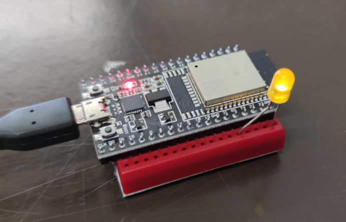

# LED · Drive strength dei GPIO ESP32

## Introduzione teorica

Il **drive strength**, o capacità di pilotaggio, configura lo stadio elettrico di uscita di un GPIO. `digitalWrite()` sceglie HIGH o LOW; il drive strength influenza il modo in cui il circuito di uscita sostiene quel livello quando il carico richiede corrente.

Un GPIO configurato come uscita push-pull può fornire corrente al carico quando è alto e assorbirla verso GND quando è basso. Lo stadio di uscita ha un’impedenza interna: sotto carico il livello HIGH può scendere rispetto alla tensione di alimentazione. Un pilotaggio più forte permette in genere di sostenere meglio il livello e modifica la carica e scarica delle capacità del collegamento. Il risultato dipende da carico, cablaggio e caratteristiche del chip.

### Livelli di pilotaggio e corrente effettiva

L’ESP32 classico espone quattro impostazioni, dalla più debole alla più forte:

| Costante | Livello |
| --- | --- |
| `GPIO_DRIVE_CAP_0` | Più debole |
| `GPIO_DRIVE_CAP_1` | Intermedio |
| `GPIO_DRIVE_CAP_2` | Più forte del livello 1 |
| `GPIO_DRIVE_CAP_3` | Più forte fra i quattro disponibili |

La funzione `gpio_set_drive_capability()` imposta il livello del pin. I valori in mA riportati nel commento iniziale dello sketch descrivono classi indicative di pilotaggio: **non rappresentano una corrente imposta al LED o misurata dal programma**. La corrente reale dipende dalla tensione d’uscita, dal LED e dalla resistenza del circuito. Per condizioni e limiti elettrici occorre consultare il datasheet del modello usato. [Espressif: configurazione GPIO](https://docs.espressif.com/projects/esp-idf/en/stable/esp32/api-reference/peripherals/gpio.html).

### Perché serve sempre una resistenza

La corrente di un LED può crescere rapidamente al variare della tensione applicata. Il drive strength **non è un limitatore di corrente**: anche al livello più debole occorre una resistenza esterna in serie, dimensionata per il LED e per il GPIO.

Usa una resistenza da **220 Ω**. Con un’uscita idealizzata a 3,3 V e un LED rosso con caduta di circa 2 V, la legge di Ohm dà:

```text
I ≈ (3,3 − 2,0) / 220 ≈ 0,0059 A = 5,9 mA
```

È una stima: la tensione del GPIO sotto carico e la caduta reale del LED cambiano il risultato. La luminosità può variare poco fra due livelli e non fornisce una misura affidabile della corrente. Per misurarla, rileva la tensione ai capi della resistenza e calcola `I = V_R / 220`.

### Differenza rispetto al PWM

Il PWM regola la frazione di tempo in cui l’uscita è alta, modificando la luminosità media. Il drive strength modifica invece le caratteristiche elettriche dell’uscita durante il pilotaggio. La resistenza rimane necessaria anche quando si usa il PWM, perché limita la corrente durante ogni impulso.

## Materiali e collegamenti

Servono ESP32 classico WROOM-32, per esempio DOIT ESP32 DEVKIT V1, un LED, una resistenza da **220 Ω**, cavetti e cavo USB dati.

```text
GPIO 21 → resistenza 220 Ω → anodo LED
GND     ← catodo LED
```

Il GPIO 21 è il pin usato dallo sketch; non coincide necessariamente con la posizione fisica 21 del connettore. Usa logica a 3,3 V e modifica i collegamenti a scheda scollegata.



La fotografia illustra la prova. Per il montaggio segui il circuito riportato sopra, con la resistenza da 220 Ω in serie al LED.

## Sketch e risultato atteso

Apri [006-LedOn_DriveStrength.ino](006-LedOn_DriveStrength.ino) in Arduino IDE, seleziona scheda e porta corrette con il core **esp32 by Espressif Systems**. Lo sketch usa l’API ESP-IDF inclusa nel core; per dichiarare esplicitamente funzione e tipi inserisci all’inizio, se necessario:

```cpp
#include "driver/gpio.h"
```

Il nome della cartella coincide già con quello del file principale. Apri il monitor seriale a **115200 baud**.

All’avvio il LED resta acceso per un secondo. Il loop prova **soltanto i livelli 0, 1 e 2**, nell’ordine: per ciascuno stampa il nome della costante e mantiene il LED acceso per 2 s, seguito da 200 ms spento. Il periodo nominale del giro è quindi 6,6 s, oltre al tempo del codice. Il livello 3 è descritto nella teoria ma non viene eseguito da questo sketch.

Le stampe indicano il livello richiesto; il programma non misura corrente o tensione e non controlla l’esito della chiamata di configurazione. Le attese sono bloccanti. Un esempio separato con tutti e quattro i livelli è disponibile nel [confronto del drive strength](../../02-Uscite-digitali-e-LED/esempi/04_01-Confronto-drive-strength/README.md).

## Simulazione e verifica pratica

È disponibile il [progetto Wokwi della dimostrazione](https://wokwi.com/projects/330929970048139859). Per riprodurre il circuito reale mantieni la resistenza da 220 Ω anche se un vecchio schema mostra un collegamento diverso. Usa il simulatore per studiare ordine e tempi; la verifica delle differenze elettriche richiede misure sul circuito fisico.

## Esercizi

1. Prevedi e verifica sulla seriale l’ordine dei livelli e il periodo nominale del giro.
2. Per ciascun livello misura la tensione sulla resistenza da 220 Ω e calcola la corrente. Confronta i valori osservati senza interpretarli come correnti fissate dalla costante.
3. A scheda scollegata sostituisci la resistenza con 1 kΩ, ripeti le misure e spiega perché la corrente diminuisce.
4. Confronta questo programma con un esempio PWM e descrivi quale parametro cambia in ciascun caso.

## Riferimenti e navigazione

- [Approfondimento sul drive strength e sulla resistenza del LED](../../02-Uscite-digitali-e-LED/04-Drive-strength-dei-GPIO.md).
- [API GPIO di Espressif](https://docs.espressif.com/projects/esp-idf/en/stable/esp32/api-reference/peripherals/gpio.html).
- [Datasheet ESP32](https://www.espressif.com/sites/default/files/documentation/esp32_datasheet_en.pdf).
- [Indice ESP32-DEVKIT](../README.md).

Documentazione verificata rispetto al codice presente; compilazione e misure fisiche non eseguite durante questo controllo.
